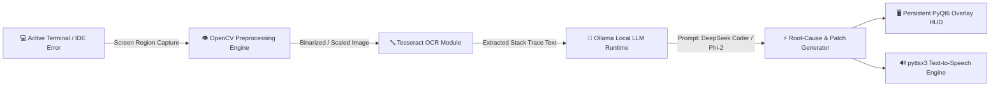

# Overlay-Based AI Debugging Assistant using OCR and Local LLMs

[](https://icaset.org)
[](https://icaset.org)
[](#)
[](https://www.python.org/)
[](https://www.qt.io/)
[](https://ollama.ai)
[](#models)

> **Best Paper Award Winner — Computer Science Track**  
> *International Conference on Advancements in Science, Engineering & Technology (ICASET 2026)*  
> **Team Lead:** **Dharshin R**

---

## 📌 Abstract & Overview

Modern software development requires developers to constantly switch between code editors, terminals, browsers, and documentation to troubleshoot runtime exceptions and syntax errors. This context switching causes cognitive friction and exposes proprietary source code and sensitive stack traces to external cloud LLM providers.

The **Overlay-Based AI Debugging Assistant** provides an offline, privacy-first desktop debugging companion that runs entirely on local hardware:
- **Zero-Egress Offline Intelligence:** Terminal errors and tracebacks are captured via optical character recognition and routed to locally hosted LLMs (`DeepSeek Coder`, `Phi-2`) via Ollama—ensuring zero source code leaves the machine.
- **Persistent Overlay Interface:** A non-intrusive PyQt6 desktop overlay HUD eliminates context switching by displaying root-cause analyses and syntax fixes directly over the developer's workspace.
- **Multi-Modal Feedback:** Combines interactive visual diffs with automated speech synthesis (`pyttsx3`) for hands-free audio explanations.

---

## 🏗️ System Architecture



### 🧩 Core Subsystem Pipeline

1. **Screen Region Acquisition:** Captures active terminal error regions without requiring copy-pasting or file upload.
2. **OpenCV Preprocessing Pipeline:** Applies grayscale conversion, adaptive thresholding, bilateral noise filtering, and 2x cubic interpolation to optimize terminal font readability.
3. **Tesseract OCR Extraction:** Extracts structured traceback strings, parsing file names, line numbers, and exception messages with high precision.
4. **Local LLM Inference Engine:** Streams the parsed error stack to locally running Ollama instances hosting `deepseek-coder:6.7b` and `phi-2`. Prompts enforce concise, actionable root-cause analysis and code patches.
5. **HUD Overlay & Audio Narration:** Renders solutions in a non-intrusive floating HUD while synthesizing audio guidance to allow continuous typing.

---

## 📊 Empirical Benchmarks & Research Results

The system was evaluated against a rigorous benchmark of **75 real-world Python error cases** spanning syntax errors, type errors, key errors, recursion limits, module import errors, and complex logical bugs:

| Evaluation Metric | Measured Benchmark Performance |
| :--- | :--- |
| **OCR Text Extraction Accuracy** | **94.2%** |
| **Mean End-to-End Latency** | **3.8 seconds** |
| **Debugging Resolution Success Rate** | **81.3%** (61/75 verified fixes) |
| **Data Egress** | **0.0 KB (100% On-Device / Air-Gapped)** |
| **Context Switching Overhead Reduction** | **~68% reduction** compared to manual search workflows |

---

## 🚀 Key Features

* **🔒 100% Privacy & Zero Data Egress:** All parsing, OCR, and model inference run locally on CPU/GPU. No telemetry or source code is uploaded to external clouds.
* **⚡ Sub-4-Second Local Reasoning:** DeepSeek Coder and Phi-2 models optimized via Ollama runtime deliver sub-4s turnaround time.
* **🖥️ Persistent PyQt6 Transparent Overlay:** Floating desktop HUD with click-through toggle, hotkey invocation, and non-blocking asynchronous UI loops.
* **🔊 Hands-Free Voice Explanation:** Built-in `pyttsx3` text-to-speech engine narrates the diagnosis so developers can keep hands on the keyboard.
* **🛠️ Cross-IDE Compatibility:** Works universally across VS Code, PyCharm, Windows Terminal, PowerShell, Linux Bash, and Command Prompt without requiring IDE plugins.

---

## 🛠️ Technology Stack

| Category | Technologies |
| :--- | :--- |
| **Languages** | Python 3.10+, JavaScript, C++ |
| **Desktop UI / Overlay** | PyQt6, Custom Window Geometry, Transparent Alpha Blending |
| **Computer Vision & OCR** | OpenCV (cv2), Tesseract OCR (`pytesseract`), Pillow |
| **Local LLM Runtime** | Ollama, DeepSeek Coder (1.3B / 6.7B), Microsoft Phi-2 |
| **Speech Synthesis (TTS)**| `pyttsx3` (Offline SAPI5 / NSSpeechSynthesizer) |
| **API & Architecture** | REST APIs (Ollama JSON endpoints), Asynchronous Threading (`QThread`) |

---

## 💻 Installation & Quickstart

### 1. Prerequisites
- **Python 3.10+**
- **Tesseract OCR**: [Install Tesseract](https://github.com/tesseract-ocr/tesseract) and ensure it is added to your system `PATH`.
- **Ollama**: [Download Ollama](https://ollama.ai) and pull the local models:
  ```bash
  ollama pull deepseek-coder:6.7b
  ollama pull phi-2
  ```

### 2. Install Python Dependencies
```bash
python -m pip install -r requirements.txt
```

### 3. Run the Assistant
```bash
python main.py
```
*(Or launch the overlay with `npm start` / `python orchestrator.py` depending on interface mode)*

---

## 📜 Conference Publication & Citation

This research was peer-reviewed, accepted, and presented at **ICASET 2026**:

```bibtex
@inproceedings{dharshin2026icaset,
  title={Overlay-Based AI Debugging Assistant using OCR and Local LLMs},
  author={Dharshin, R. and Collaborators},
  booktitle={Proceedings of the International Conference on Advancements in Science, Engineering & Technology (ICASET 2026)},
  series={Computer Science Track},
  year={2026},
  note={Winner of Best Paper Award}
}
```

---

## 👥 Project Leadership

- **Dharshin R** — *Team Lead, System Architect & Research Presenter*
