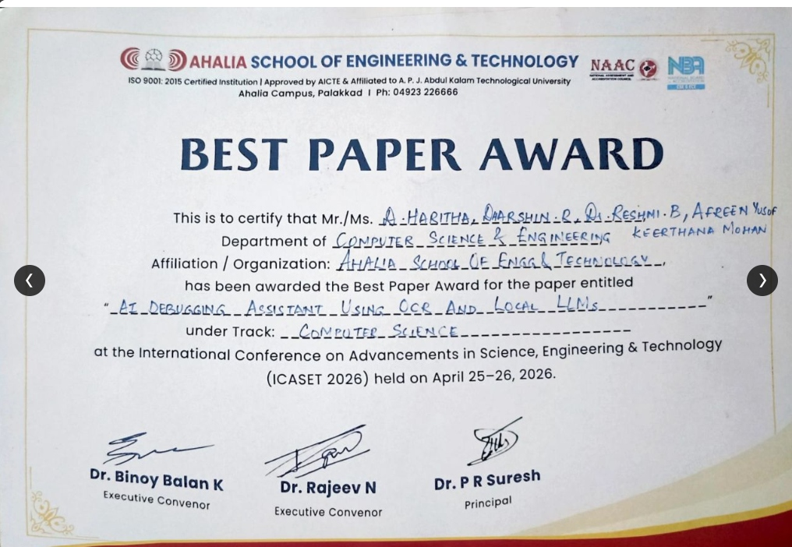
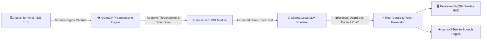

# AI Debugging Assistant Using OCR and Local LLMs

<p align="center">
  
</p>

<p align="center">
  <a href="#-best-paper-award--publication"></a>
  <a href="#-best-paper-award--publication"></a>
  <a href="#-research-team--author-contributions"></a>
  <a href="https://www.python.org/"></a>
  <a href="https://www.qt.io/"></a>
  <a href="https://ollama.ai"></a>
  
</p>

> 🏆 **Winner of the Best Paper Award (Computer Science Track)**  
> *International Conference on Advancements in Science, Engineering & Technology (ICASET 2026)*  
> Held on **April 25–26, 2026** at **Ahalia School of Engineering & Technology, Palakkad**  
> **Team Lead:** **Dharshin R**

---

## 📌 Abstract & Research Overview

Modern software development requires developers to continuously context-switch across IDE code editors, terminals, browsers, and documentation forums to troubleshoot runtime exceptions and syntax tracebacks. This fragmented workflow induces cognitive fatigue and frequently exposes proprietary source code and sensitive stack traces to external cloud LLM providers.

The **AI Debugging Assistant Using OCR and Local LLMs** introduces an offline, privacy-preserving desktop debugging companion that operates 100% on local hardware:
- **Zero-Egress Local Inference:** Terminal error tracebacks are captured optically from the screen and streamed to locally hosted LLMs (`DeepSeek Coder`, `Phi-2`) via Ollama—ensuring zero source code leaves the developer's computer.
- **Persistent Overlay Interface:** A non-intrusive PyQt6 transparent HUD overlay displays root-cause diagnostics, explanations, and code patches directly over the developer's active workspace.
- **Multi-Modal Interaction:** Integrates real-time visual code diffs with hands-free auditory feedback via local text-to-speech synthesis (`pyttsx3`).

---

## 🏗️ System Architecture



### 🧩 Subsystem Engineering Pipeline

1. **Screen Region Acquisition:** Captures bounding coordinates of the active terminal error window with zero manual copy-pasting.
2. **OpenCV Preprocessing Pipeline:** Applies grayscale conversion, adaptive thresholding, bilateral noise reduction, and 2x cubic interpolation to maximize OCR accuracy on varied terminal color schemes.
3. **Tesseract OCR Extraction:** Extracts structured exception traces, automatically parsing filenames, line numbers, error types, and stack calls.
4. **Local LLM Inference Engine:** Feeds the extracted traceback to locally hosted Ollama instances running `deepseek-coder:6.7b` and `phi-2`, enforcing concise root-cause analysis and drop-in code patches.
5. **HUD Overlay & Audio Narration:** Renders diagnostic solutions on a transparent floating HUD while audibly reading fixes to maintain uninterrupted developer flow.

---

## 📊 Empirical Benchmarks & Experimental Results

The system was evaluated against a standardized benchmark of **75 real-world Python error cases** spanning syntax errors, type errors, recursion limits, missing dependencies, key errors, and logical bugs:

| Benchmark Metric | Measured Performance |
| :--- | :--- |
| **OCR Text Extraction Accuracy** | **94.2%** |
| **Mean End-to-End Latency** | **3.8 seconds** |
| **Debugging Resolution Success Rate** | **81.3%** (61/75 verified correct fixes) |
| **Data Egress** | **0.0 KB (100% On-Device / Air-Gapped)** |
| **Context Switching Overhead** | **~68% reduction** compared to manual web lookup |

---

## 👥 Research Team & Author Contributions

This project and research paper were conceived, developed, and evaluated collaboratively by the following team from the **Department of Computer Science & Engineering, Ahalia School of Engineering & Technology**:

| Author | Role & Specialization | Key Architectural & Research Contributions |
| :--- | :--- | :--- |
| **Dharshin R** | **Team Lead & Principal System Architect** | Overall project conception and leadership; designed end-to-end system architecture; integrated local LLM inference engines (Ollama, DeepSeek Coder, Phi-2); authored manuscript and delivered conference presentation defense. |
| **D. Haritha** | **Frontend & UI/UX Development** | Designed and engineered the persistent, transparent PyQt6 desktop overlay HUD; implemented screen-capture region selection, visual hierarchy, and interaction ergonomics. |
| **Keerthana Mohan** | **Backend & Engine Design** | Architected the core backend processing pipeline; implemented OpenCV image preprocessing routines (binarization, thresholding) and Tesseract OCR integration. |
| **Afreen Yusof** | **QA, Testing & Empirical Benchmarking** | Formulated the empirical evaluation methodology across 75 real-world Python error test cases; gathered benchmark telemetry (accuracy, latency, resolution rates); performed validation audits. |
| **Dr. Reshmi B** | **Faculty Advisor & Research Mentor** | Academic guidance, research methodology oversight, paper peer-review structuring, and institutional support. |

---

## 🛠️ Technology Stack

| Category | Technologies |
| :--- | :--- |
| **Languages** | Python 3.10+, JavaScript, C++ |
| **Desktop UI / Overlay** | PyQt6, Custom Window Geometry, Transparent Alpha Blending, Electron |
| **Computer Vision & OCR** | OpenCV (cv2), Tesseract OCR (`pytesseract`), Pillow |
| **Local LLM Runtime** | Ollama, DeepSeek Coder (1.3B / 6.7B), Microsoft Phi-2 |
| **Speech Synthesis (TTS)**| `pyttsx3` (Offline SAPI5 / NSSpeechSynthesizer), Piper TTS |
| **API & Architecture** | REST APIs (Ollama JSON endpoints), Asynchronous Threading (`QThread`) |

---

## 💻 Installation & Quickstart

### 1. Prerequisites
- **Python 3.10+**
- **Tesseract OCR**: [Install Tesseract](https://github.com/tesseract-ocr/tesseract) and ensure it is on your system `PATH`.
- **Ollama**: [Download Ollama](https://ollama.ai) and pull the local coding models:
  ```bash
  ollama pull deepseek-coder:6.7b
  ollama pull phi-2
  ```

### 2. Install Python Dependencies
```bash
python -m pip install -r requirements.txt
```

### 3. Run the Assistant
```bash
python main.py
```

---

## 📜 Best Paper Award & Publication

This paper was presented and won the **Best Paper Award** at **ICASET 2026**:

```bibtex
@inproceedings{haritha2026aidebugger,
  title={AI Debugging Assistant Using OCR and Local LLMs},
  author={Haritha, D. and Dharshin, R. and Reshmi, B. and Yusof, Afreen and Mohan, Keerthana},
  booktitle={Proceedings of the International Conference on Advancements in Science, Engineering & Technology (ICASET 2026)},
  series={Computer Science Track},
  organization={Ahalia School of Engineering and Technology, Palakkad},
  month={April 25--26},
  year={2026},
  note={Winner of the Best Paper Award}
}
```

---

## 📄 License
This project is licensed under the MIT License — see the [LICENSE](LICENSE) file for details.
